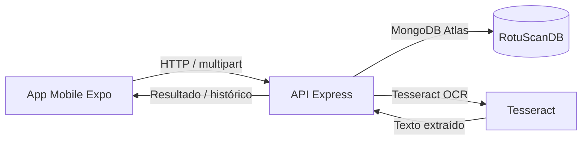
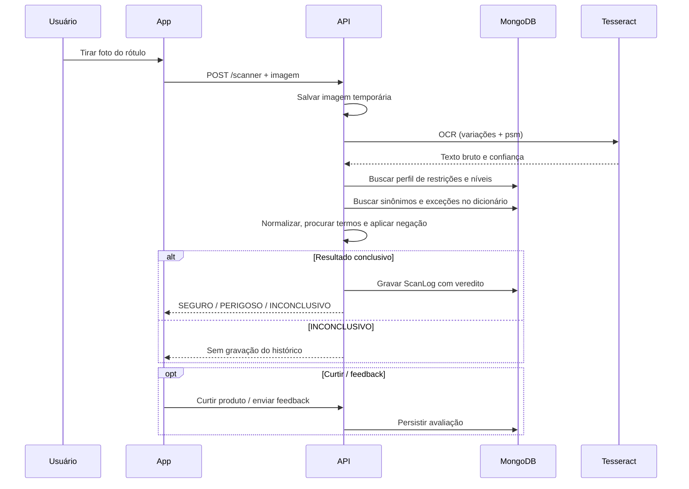

# RotuScan

> Sistema de apoio à segurança alimentar para identificação de alérgenos em rótulos por meio de OCR, regras de negócio e perfil do paciente.

      

## Índice

- [Sobre o projeto](#sobre-o-projeto)
- [Funcionalidades](#funcionalidades)
- [Registro de alterações](#registro-de-alterações)
- [Arquitetura](#arquitetura)
- [Tecnologias](#tecnologias)
- [Estrutura de pastas](#estrutura-de-pastas)
- [Pré-requisitos](#pré-requisitos)
- [Credenciais e acesso ao banco](#credenciais-e-acesso-ao-banco)
- [Passo a passo](#passo-a-passo)
- [Roteiro de avaliação](#roteiro-de-avaliação)

## Sobre o projeto

O RotuScan nasceu para reduzir a incerteza na leitura de rótulos e dar suporte prático ao paciente com restrições alimentares. O sistema combina app mobile, backend em Node.js/Express e OCR em Tesseract para identificar ingredientes e traços de alérgenos como glúten, lactose e amendoim.

### Problema

- rótulos alimentícios com listas longas, termos pouco legíveis e variações de apresentação;
- dificuldade de interpretar alertas como “Pode conter...”, “sem glúten”, “contém derivados”;
- risco de decisões erradas sem contexto de sensibilidade do usuário.

### Solução

- o paciente usa o app para capturar a foto do rótulo;
- o backend preprocessa a imagem e executa OCR em múltiplas variantes;
- o motor cruza os termos com o dicionário de alérgenos e o nível de sensibilidade cadastrado;
- o app entrega um veredito com status, justificativa e histórico.

### Mão dupla: paciente ↔ nutricionista

O repositório atual cobre a experiência do paciente no app mobile e a API do backend. O painel do nutricionista é uma frente separada em outra tecnologia, acessando o mesmo banco de dados (`RotuScanDB`) e compartilhando regras de restrição, vínculo e histórico.

### Instituição e equipe

- Instituição: FATEC Registro / DSM
- Equipe/apoio: Saluscore
- Objetivo: apoiar diagnóstico, educação alimentar e gestão segura das restrições do usuário.

## Funcionalidades

| Tela | O que faz | Status |
| --- | --- | --- |
| Splash | Validação de sessão e redirecionamento | ✅ |
| Login | Autenticação com e-mail e senha | ✅ |
| Cadastro | Criação do paciente com validação e código opcional | ✅ |
| Vínculo com nutricionista | Consulta e associação por código | ✅ |
| Seleção de intolerâncias | Definição inicial de alergias e níveis | ✅ |
| Home | Dashboard com chips, perfil e acesso rápido | ✅ |
| Scanner | Captura da imagem e envio para análise | ✅ |
| Resultado detalhado | Veredito + lista de ingredientes e alertas | ✅ |
| Histórico | Busca e filtros por risco/segurança | ✅ |
| Itens curtidos | Produtos favoritados e marcados | ✅ |
| Perfil | Dados do usuário e vínculo | ✅ |
| Editar perfil | Ajuste de intolerâncias e níveis com confirmação | ✅ |
| Configurações | Ajustes gerais e sessão | ✅ |
| Feedback | Avaliação do usuário e suporte | ✅ |
| Menu | Navegação e consistência do app | ✅ |

## Registro de alterações

| Fase | O que mudou | Arquivos principais |
| --- | --- | --- |
| MVP inicial | Estrutura do scanner, OCR e regras anti-falso-positivo | `server/services/ocrAnalyzer.js`, `server/server.js`, `server/utils/texto.js` |
| Banco unificado | Centralização em `RotuScanDB`, models e scripts de diagnóstico | `server/models/*.js`, `docs/contrato-banco.md` |
| Autenticação | JWT, cadastro, login, vinculação e validação de permissões | `server/middleware/auth.js`, `server/server.js` |
| Onboarding e perfil | Seleção de intolerâncias, níveis e edição de perfil | `mobile/app/selectIntolerancia.tsx`, `mobile/app/editar-perfil.tsx`, `mobile/components/SensitivitySlider.tsx` |
| Home e dados reais | Dados do usuário e histórico consumindo o backend real | `mobile/app/home.tsx`, `mobile/context/AuthContext.tsx` |
| OCR refinado | Variações de imagem, psm, confiança, fuzzy, normalização e exceções | `server/services/ocr/extractText.js` |
| Detecção multi-alérgeno | Lookup de restrições, sinônimos e nível de sensibilidade | `server/services/ocrAnalyzer.js` |
| Histórico, favoritos e feedback | Exibição e persistência do contexto do usuário | `mobile/app/historico.tsx`, `mobile/app/itensCurtidos.tsx`, `server/models/Feedback.js` |
| Scripts e manutenção | Diagnóstico, seed, backup e migração | `server/scripts/*.js` |
| Limpeza do código | Reorganização e documentação técnica | `docs/metodologia-ocr.md`, `README.md`, `CONTEXTO.md` |

## Arquitetura

### Visão geral



### Fluxo de escaneamento



## Tecnologias

| Tecnologia | Versão real |
| --- | --- |
| Node.js | 22.20.0 |
| Express | 5.3.0 |
| Mongoose | 9.11.4 |
| Sharp | 0.35.5 |
| node-tesseract-ocr | 2.2.1 |
| React Native | 0.88.1 |
| Expo | ~58.0.22 |
| Expo Router | ~58.0.29 |
| React | 19.3.0 |
| TypeScript | ~6.0.3 |
| MongoDB Atlas | RotuScanDB |
| Tesseract OCR | 5.5.0 |

## Estrutura de pastas

```text
rotuscan-mobile/
├── CONTEXTO.md                      # Visão geral de contexto e arquitetura do projeto
├── README.md                       # Documentação pública geral
├── LICENSE                         # Licença do projeto
├── docs/
│   ├── contrato-banco.md           # Contrato do banco e regras de negócio
│   └── metodologia-ocr.md         # Pipeline de OCR, regras de negação e fuzzy match
├── mobile/
│   ├── app/                        # Rotas do app (login, scanner, histórico, perfil, etc.)
│   ├── components/                 # UI compartilhada, sliders, modais e cabeçalhos
│   ├── context/                    # AuthContext e estado global do usuário
│   ├── hooks/                      # Regras de draft e estado de edição
│   ├── services/                   # Cliente API e integrações
│   ├── assets/                     # Imagens e recursos visuais
│   └── package.json                # Dependências do app Expo
├── server/
│   ├── middleware/                 # Autenticação JWT e middlewares
│   ├── models/                     # User, ScanLog, Feedback, AllergenDictionary
│   ├── scripts/                    # Seeds, diagnóstico, migração e smoke tests
│   ├── services/                   # OCR, análise de texto e integração do motor
│   ├── utils/                      # Normalização de texto e helpers
│   ├── seeds/                      # Dicionários iniciais e dados de apoio
│   ├── .env                        # Configuração local real (não versionado no Git)
│   ├── package.json                # Dependências do backend
│   └── server.js                   # Ponto central da API Express
└── .gitignore
```

## Pré-requisitos

| Item | Versão / exigência | Onde baixar | Como verificar |
| --- | --- | --- | --- |
| Node.js | 22.x | https://nodejs.org | `node -v` |
| Git | 2.x+ | https://git-scm.com | `git --version` |
| Tesseract OCR | 5.x com idioma `por` | https://github.com/UB-Mannheim/tesseract/wiki | `tesseract --list-langs` |
| Expo Go | compatível com SDK 58 | App Store / Google Play | Instalar no celular |
| Wi-Fi | celular e PC na mesma rede | local | `ipconfig` + teste de ping |

## Credenciais e acesso ao banco

> O projeto usa `RotuScanDB` no MongoDB Atlas como banco compartilhado da solução. Em ambiente local, o arquivo `server/.env` deve conter os valores reais da integração. O modelo atual armazenado no repositório apresenta a URI de avaliação com o host do cluster e o banco, preservando os valores reais conhecidos pelo ambiente local.

| Campo | Valor |
| --- | --- |
| Cluster | `rotuscan-cluster.23cdx3v.mongodb.net` |
| Banco | `RotuScanDB` |
| Usuário | configurado no `.env` do servidor |
| Senha | configurada no `.env` do servidor |
| `MONGODB_URI` | `******rotuscan-cluster.23cdx3v.mongodb.net/RotuScanDB?retryWrites=true&w=majority` |
| `PORT` | `3000` |
| `JWT_SECRET` | `rotuscan_segredo_super_seguro` |

### Conectando no MongoDB Compass

```text
mongodb+srv://<usuario>:<senha>@rotuscan-cluster.23cdx3v.mongodb.net/RotuScanDB?retryWrites=true&w=majority
```

### Alternativa local

```env
MONGODB_URI=mongodb://127.0.0.1:27017/RotuScanDB
PORT=3000
JWT_SECRET=rotuscan_segredo_super_seguro
```

## Passo a passo

### 1) Clonar o projeto

```bash
git clone <url-do-repositorio>
cd rotuscan-mobile
```

### 2) Instalar o Tesseract

No Windows, use o pacote UB Mannheim e marque o idioma `Portuguese (por)`. Em seguida, confirme:

```powershell
tesseract --list-langs
```

Se o binário não estiver no padrão, configure:

```env
TESSERACT_PATH=C:\Program Files\Tesseract-OCR\tesseract.exe
TESSDATA_DIR=C:\Program Files\Tesseract-OCR\tessdata
```

### 3) Configurar o backend

Crie `server/.env` com:

```env
MONGODB_URI=******rotuscan-cluster.23cdx3v.mongodb.net/RotuScanDB?retryWrites=true&w=majority
PORT=3000
JWT_SECRET=rotuscan_segredo_super_seguro
TESSERACT_PATH=C:\Program Files\Tesseract-OCR\tesseract.exe
```

Em seguida:

```bash
cd server
npm install
node server.js
```

Saída esperada:

- conexão bem-sucedida com MongoDB Atlas;
- carregamento do dicionário;
- API respondendo em `http://localhost:3000`.

### 4) Configurar o app mobile

Descubra o IP do computador:

```powershell
ipconfig
```

Crie `mobile/.env` com:

```env
EXPO_PUBLIC_API_URL=http://SEU_IP:3000
```

Instale as dependências:

```bash
cd mobile
npm install
npx expo start -c
```

Depois abra o app Expo Go e escaneie o QR code.

### 5) Regra de firewall (Windows)

Se a API não responder do celular, abrir a porta `3000` em PowerShell como administrador:

```powershell
netsh advfirewall firewall add rule name="RotuScanPort3000" dir=in action=allow protocol=TCP localport=3000
```

### 6) Dados de demonstração

```bash
cd server
npm run seed:demo -- <email>
```

## Roteiro de avaliação

1. Acessar a tela de cadastro e criar um paciente.
2. Validar a autenticação com login real.
3. Escolher intolerâncias e ajustar os níveis de sensibilidade.
4. Vincular o paciente a um nutricionista com código.
5. Capturar uma foto de um rótulo com boa iluminação.
6. Validar o resultado do scanner e o diagnóstico em `SEGURO`, `PERIGOSO` ou `INCONCLUSIVO`.
7. Confirmar leitura de termos e menções de traços.
8. Revisar o histórico de escaneamentos e filtros.
9. Verificar o perfil, edição de intolerâncias e restaurar padrões.
10. Testar feedback e curtidas.
11. Confirmar que o backend responde corretamente na porta `3000`.
12. Validar a configuração de `EXPO_PUBLIC_API_URL` e funcionamento no celular na mesma rede.

> 🚧 O projeto está pronto para execução e uso local em ambiente de avaliação. Trechos incompletos ou evoluções futuras devem ser considerados em desenvolvimento.

## Observações finais

- A documentação técnica do OCR está em [`docs/metodologia-ocr.md`](./docs/metodologia-ocr.md).
- A arquitetura e as regras de banco estão em [`docs/contrato-banco.md`](./docs/contrato-banco.md).
- O contexto e o mapa do código estão em [`CONTEXTO.md`](./CONTEXTO.md).
- A limpeza e revisão do repositório devem ser executadas com cuidado, respeitando o controle de versão e a integridade dos arquivos relevantes.
